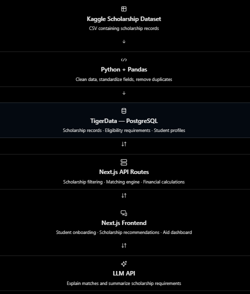

# Project Idea: Funds for Future 

Description: Place centralized place to find funds like government aids, scholarships, or **student loans** for students pursuing higher education: bachelor’s, master’s, or PhD. 

Problem: Students navigate college funds like government aids, scholarships, and [student loans] are scattered and it’s hard for students to manage everything. 

Goals: Discover scholarships and grants and track scholarship applications

Target users: students preparing for college (undergraduate students, transfer students, graduate students, and high school seniors preparing for college) 

## Features:

| Modules | Functionality | Priority |
| Student Profile | Education, major, enrollment, academic background, financial eligibility indicators | High
| Scholarship Discovery | Search, filter, and match scholarships to student profiles (add a matching score generated by AI) | High |
| Financial Aid Calculator | Estimate the remaining college costs subtracting scholarships and grants from the tuition | Medium | 
| Application Tracker | Save scholarships, track statuses, deadlines, and reminders | Low |

## Requirements:
- Create a user interface for students to enter their information 
    - What information do we want? 
        1) Contact: Phone number, email, country, and state 
        2) School-related: Major, GPA, education 
        3) Are you doing FAFSA? If so, what is your SAI score? 
- Load scholarship information: 
    - Kaggle scholarship dataset: https://www.kaggle.com/datasets/timmofeyy/-universities-schoolarships-all-around-the-world?resource=download
    - Scholarship Fields:
        - The company/scholarship name
        - Amounts
        - Deadline 
- Matching based on eligibility rules 
    - Minimum gpa
    - Major 
    - [Income based]
    - [Ethinicity]

- After matching, it should give a list of scholarships and when you click on them, it will provide the following information:
    - Scholarship Name
    - External Link to their application (if available) 
    - Requirement (Essay, certain race, income) 
        - Dropboxes for income: (are you dependent or not) 
            - If yes, Low income (49,500 - 82,500), middle class (82,500-132,000), Upper (greater than 132,000) 
- Financial Aid Calculator that calculates the difference between the tuition and potential scholarships
    - Simple diagram that shows the expected amount the student has to pay

## System Architecture 

### UML Class Diagram

### Flowchart
Student profile → Next.js server → Query TigerData
                                 → Evaluate eligibility rules
                                 → Return matches and explanations

